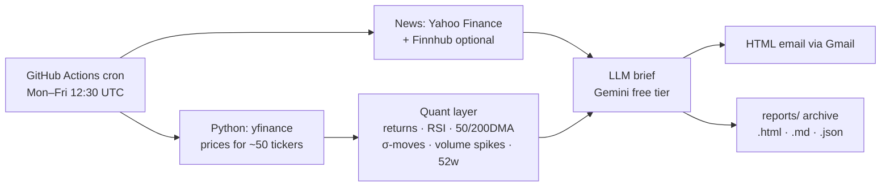

# Daily US Market Brief · 每日美股研究简报

An automated pre-market research brief: **Python** computes the quant layer, an **LLM** writes the narrative, and **GitHub Actions** runs it every trading day and emails the result. Runs entirely on free tiers: GitHub Actions, Yahoo Finance data and the **Gemini API free tier** for the LLM (free key, no credit card).



**Coverage (edit `config.yaml`):** SPY / QQQ / VIX · Magnificent 7 · Semis & Compute (SMH) · Aerospace & Defense (ITA) · Consumer Staples (XLP) · Clean Energy (ICLN) · Biotech (XBI) · Precious Metals & Commodities (gold, silver, platinum, copper, WTI, natural gas; DBC).

## What the quant layer computes

| Metric | Definition |
|---|---|
| 1D / 5D / 1M / YTD return | adjusted close |
| RSI(14) | Wilder smoothing; flags > 70 / < 30 |
| vs 50DMA / 200DMA | % distance; flags 200DMA breaks and 50/200 crosses in the last 5 sessions |
| σ-move | today's return ÷ prior 20-day daily volatility; flags \|z\| ≥ 2 |
| Volume ratio | today ÷ prior 20-day average; flags ≥ 2× |
| 52-week high/low | flags closes within 1% |
| Sector score | sector ETF return (or equal-weight average where no ETF) |

Signals are ranked by strength and passed to the LLM together with the full table and recent headlines. The system prompt forbids invented numbers or causes and requires "no clear catalyst" when no headline matches a move. If the model call fails, a rule-based summary is used, so the email always goes out.

## Project layout

```
main.py                 entry point (fetch → analyze → summarize → render → email → save)
config.yaml             watchlist, language, colors, signal thresholds, LLM choice
src/data.py             yfinance prices + news, Finnhub market news
src/analysis.py         indicators, signals, sector aggregates
src/llm.py              prompt, payload builder, Gemini / Anthropic / OpenAI, rule-based fallback
src/report.py           HTML email (Jinja2 template in templates/)
src/emailer.py          Gmail SMTP
src/demo.py             synthetic data for offline runs
tests/                  pytest
.github/workflows/      daily schedule
```

---

## 部署步骤（中文）

### 1. 本地先跑一遍
```bash
pip install -r requirements.txt
python main.py --demo          # 离线假数据，打开 reports/demo-*.html 看效果
python main.py --no-email      # 真实数据，不发邮件
pytest -q
```

### 2. 准备两样免费的东西
| 用途 | 去哪拿 | 对应 Secret |
|---|---|---|
| AI 写简报 | aistudio.google.com → Get API key → Create API key（免费，不绑卡；**不要**给这个项目开 billing） | `GEMINI_API_KEY` |
| 发邮件 | Google 账号 → 安全性 → 开启两步验证 → 「应用专用密码」生成 16 位密码 | `EMAIL_USER`（你的 Gmail）、`EMAIL_APP_PASSWORD` |
| 收件人 | 可以是自己，多个用逗号分隔 | `EMAIL_TO` |
| （可选）大盘新闻 | finnhub.io 免费注册 | `FINNHUB_API_KEY` |

> 注意：`EMAIL_APP_PASSWORD` 是应用专用密码，不是 Gmail 登录密码。没填邮箱 Secret 时程序照样运行，只是不发邮件，简报仍会存进 `reports/`。
> 免费版 Gemini 的输入可能被 Google 用于改进产品，这里只发送公开行情和新闻标题，没有个人信息。
> 想换成付费的 Claude / OpenAI：在 config 里改 `provider`，`pip install anthropic` 或 `openai`，再添加对应的 API key Secret。

### 3. 放到 GitHub
1. 新建仓库（Public 或 Private 都行），把整个文件夹推上去。
2. 仓库 → **Settings → Secrets and variables → Actions → New repository secret**，逐个添加上表的 Secret。
3. 仓库 → **Actions** → 选 *Daily US Market Brief* → **Run workflow** 手动跑一次，几分钟后查邮箱。
4. 之后每周一到周五 UTC 12:30（太平洋时间凌晨 4:30，夏令时 5:30）自动运行；每天的简报也会存进 `reports/`。

### 4. 常见调整
- 换股票 / 加板块：改 `config.yaml` 的 `groups`。
- 英文简报：`language: en`。涨红跌绿：`up_color: red`。
- 改发送时间：改 workflow 里的 `cron`（UTC 时间）。
- Yahoo 偶尔会限制 GitHub 服务器的访问；代码会自动重试，缺失的代码会写在邮件底部。如果经常失败，可以把 `src/data.py` 换成 Tiingo / Alpha Vantage 等有免费 key 的数据源。

## Ideas for v2
- Track signal hit-rates: the daily `.json` archive is already a dataset — measure forward 5-day returns after each signal type.
- Earnings calendar and macro calendar (CPI, FOMC) sections.
- Publish `reports/` with GitHub Pages as a public research log.

*Research tool only. Not investment advice.*
